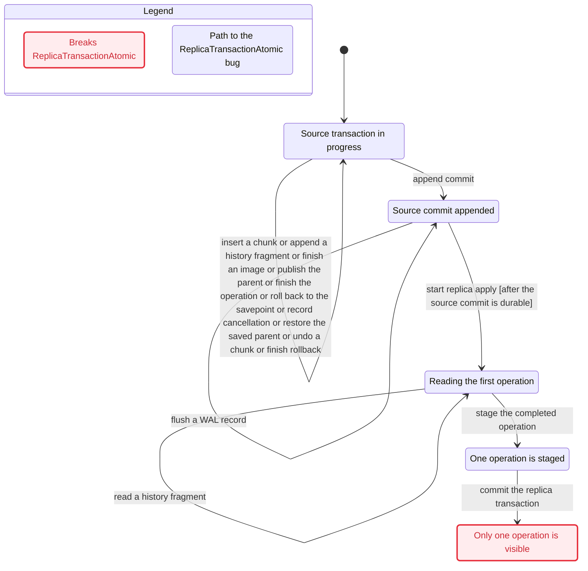

# Sidecar publication, cancellation, recovery, and replica boundary

## Promise and scope

The model checks one shared execution of a proposed Sidecar mutation protocol. A published parent names a complete local value and history image. A savepoint rollback preserves its earlier operation and cancels the later operation in the history that the source durably commits. A retained snapshot keeps its old value. Restart reconstructs retention before it reopens archive deletion or garbage collection. The replica stages every surviving operation from the source transaction before one atomic commit of the complete batch and its progress. A retry does not apply an operation twice. A failure can expose an incomplete value, lose a saved operation, publish a rolled-back event, discard required WAL, or duplicate a replica update.

These are proposed protocol obligations, not claims about the current engine. The source context is CUBRID commit `e64a04a79a5842827a124b3f8313516d0da2594c`. The design basis is `sidecar/codex-20261104/design.md` in `/home/vimkim/gh/my-cubrid-docs-sidecar-codex`, commit `12b1d0d20a0669ff0401c8290e672d65198aaf0d`. The relevant sections are `One owner defines retirement`, `Physical undo is a prerequisite`, and `Historical values are independent of live chunks`. `grounding.md` and `review.md` distinguish source observations from the proposal.

## Shared contracts and limits

`History == INSTANCE SidecarHistory WITH ...` uses the actual history module, not a copy of its predicates. The boundary's `wal`, `durable`, `archive`, `source`, `pins`, `installed`, and `replica` are substituted into the history module. Its sole consumer offset is the replica's durable `progress`. The boundary sets the unused `events` and `witnesses` to empty values, maps `history` to the empty non-replica reader function, sets `scan` to `MaxOps + 1`, and sets the history fault to `none` except in the `writer_swapped` producer control. Thus the boundary assumes event discovery is complete at durable commit. The detailed history model checks a separate, delayed enumeration cursor and retention during that enumeration. The event-discovery abstraction is not a proof that these executions refine one another.

The instance supplies `Record`, `Marker`, `Fragment`, `Refs`, `Positions`, `FirstPos`, `ManifestPos`, `FragmentPos`, `ManifestComplete`, `RetentionFloor`, `DurableCommit`, `DurableCancels`, `ExpectedEvents`, `DurableAcknowledgement`, `RetainedDependencies`, `CancellationMetadataRetained`, `ReplicaCommittedPrefix`, `HistoryReadExact`, `ReplicaAtMostOnce`, and `ReplicaTransactionAtomic`. The boundary uses these actual operators in its transitions or checked properties. A qualified import does not execute the history module's `Init` or `Next`.

The boundary retains the WAL sequence as a specification oracle after `archive` passes a record. Actions that stage fragments check that their positions remain after `archive`. Durable commit and expected-event predicates can still inspect the oracle after the replica has drained. This assumes the system retains durable transaction and replica progress facts independently of a deleted archive. It admits no new consumer after the one replica has drained. It does not model an implementation that reads a deleted record.

Lifetime state is not instantiated. The mapping below follows the lifetime coverage exports `Publish`, `Finish`, `Commit`, `StartSaveUndo`, `UndoEffect`, `FinishUndo`, and `Eligible`. It is a correspondence between named events and fields, not a machine-checked refinement. In particular, the boundary does not prove `SidecarLifetime!ObservationOK`, `Resolve`, `VisibleValueComplete`, effective MVCC family identity, foreign snapshot visibility, index undo, or physical chunk layout. `oldLive` abstracts the old snapshot's whole value as one unit. `CollectOld` does not reproduce each vacuum action.

Physical undo is an explicit assumption. Each `UndoLogicalChunk` or `RecoverChunk` assumes an undo effect can complete without losing a committed competing insert. The independent `SidecarUndo` model checks the proposed slot, byte, page-lifetime, and committed-competitor invariants `UndoSlotSafe`, `UndoBytesSafe`, `UndoPageSafe`, and `CommittedPreserved` under its declared policy and bounds. This boundary model does not instantiate those invariants or the allocator. It does not prove that the engine implements a reservation or latch policy, that recovery undoes losing inserts before restoring their deleted image, or that the detailed undo and boundary actions refine one shared implementation. The undo model imports loser-before-delete-undo ordering as an assumption.

## State and atomic events

`op[o]` records the local chunk count, whether its parent is published, whether savepoint undo is underway, whether the operation is finished and cancelled, and the restored parent captured at rollback completion. `current` admits operations in order. Operation 1 finishes before the savepoint. Operation 2 is rolled back. Operations 1 and 3 survive the commit. `parent` is the writer's current parent, and `saved` is the savepoint's parent. The model excludes own reads during partial rollback. Its single writer assumes the lifetime model's parent lock remains held until commit or abort. The old-snapshot guard corresponds to `SidecarLifetime.Eligible`, but family visibility and locking are not represented here.

`wal` is the history model's ordered sequence of typed records. `durable` is its flushed prefix and `archive` its deleted prefix. `pins` and `installed` track construction protection and durable dependency metadata. `source` carries the source phase, crash count, recovery cursor, acknowledgement, and last recovery result. `snapshot` and `oldLive` represent one old reader and its old value. `replica` carries the current image staging buffer, the staged transaction batch, durable data, durable progress, and a bounded crash count. `violations` records reclamation attempted while recovery is still active, even if the attempted deletion would otherwise be safe.

Every row below is one atomic transition in this model. The related detailed actions have their own state and do not run automatically through the instance.

| Boundary event | Effect and relationship to detailed events |
| --- | --- |
| `InsertChunk` | Adds one of two local chunks. It abstracts one `SidecarLifetime.ChunkInsert`; chunk bytes, MVCC deletes, and indexes are omitted. |
| `AppendFragment` | Appends one actual `SidecarHistory.Fragment`. The first append and construction pin are atomic, matching `SidecarHistory.AppendFragment`. |
| `AppendManifest` | Appends the actual history record and all fragment references after the full image. It corresponds to `SidecarHistory.AppendManifest`. |
| `Publish` | Changes the writer's parent after the two chunks and actual manifest are ready. It corresponds to `SidecarLifetime.Publish` with an additional history-image precondition. |
| `FinishOperation` | Completes one surviving operation. Finishing operation 1 also records the nonempty savepoint prefix. It abstracts lifetime `Finish` and history `AdvanceOperation`. |
| `StartRollback`, `NotifyCancellation` | Start rollback and append the cancellation in separate transitions. They correspond to lifetime `StartSaveUndo` and history `BeginRollback` and `AppendCancel`. |
| `UndoParent`, `UndoLogicalChunk`, `FinishRollback` | Restore the saved parent, undo one local chunk per action, then finish rollback only after the cancellation record exists. They abstract the lifetime undo journal's separate `UndoEffect` and `FinishUndo` steps. They do not reproduce every journal entry. |
| `AppendCommit`, `Flush`, `Acknowledge` | Append commit, advance the durable WAL prefix by one record, and acknowledge a durable commit in separate transitions. They correspond to history `AppendCommit`, `FlushPrefix`, and `Acknowledge`. The lifetime transaction's commit and the history durable commit are identified at this boundary; that identification remains an implementation obligation. |
| `InstallMetadata`, `ReleasePin`, `ReleaseDependencies` | Install durable manifest metadata, release a construction pin after that handoff, and release dependencies once the only replica is done or the transaction aborts. They correspond to the history retention events. |
| `DeleteArchive`, `CloseSnapshot`, `CollectOld` | Delete one archive record, close the old snapshot, or collect its abstract old value. The first uses the imported retention floor. The last abstracts lifetime `Collect` and is blocked by an open snapshot. |
| `SourceCrash`, `Replay`, `RecoverParent`, `RecoverChunk`, `FinishRecovery` | Crash discards the nondurable WAL suffix and closes reclamation. Replay reads one surviving record and restores its protection. If commit was not durable, parent undo and individual chunk undo finish before abort. If commit was durable, recovery preserves the committed local result. Replay begins after the archive prefix. These steps abstract history `SourceCrash`, `ReplayRecord`, and `FinishRecovery` and the lifetime/undo recovery obligations. |
| `BeginReplica`, `StageFragment`, `FinishReplicaEvent`, `CommitReplica` | Read one retained fragment per step and append each completed image to a volatile transaction batch. Only after every surviving operation is staged does one local commit persist the full batch and its progress. They correspond to history `BeginReplica`, `DecodeFragment`, `StageOperation`, and the safe `CommitReplica`. |
| `ReplicaCrash`, `RestartReplica` | Discard the partial image and uncommitted transaction batch on crash while retaining committed data and progress, then restart. They correspond to the history replica crash and restart actions. |

`UndoLogicalChunk` represents a logical effect only. Physical destination safety is imported as an assumption, not implemented by that action. `SaveProgress` is reachable only under the deliberately unsafe split-commit fault. `Done` stutters only after the source has aborted or has acknowledged a durable commit, the snapshot is closed, the replica has finished, and the abstract reclamation and dependency obligations are settled. Deadlock checking is enabled.

## Safety and progress

`TypeOK` checks finite state shapes and is structural. The semantic properties are `PublishedReady`, `HistoryImagesComplete`, `SavepointPrefix`, `CancellationChunksRestored`, `AbortRestored`, `CancellationAgreement`, `CommitReady`, `DurableAcknowledgement`, `RetainedDependencies`, `CancellationMetadataRetained`, `GCRecoverySafe`, `ArchiveRecoverySafe`, `SnapshotSafe`, `ReplicaCommittedPrefix`, `HistoryReadExact`, `ReplicaAtMostOnce`, and `ReplicaTransactionAtomic`. Each has an individual fault configuration below. The history-named wrappers invoke the imported history predicate, except `HistoryImagesComplete`, which applies its imported `ManifestComplete` to each manifest. `ReplicaTransactionAtomic` checks that the exposed replica data contains either no operation or every surviving operation of the source transaction. `HistoryReadExact` checks the imported history reader property against the actual replica data and progress. The two-operation commit witness makes this check non-vacuous. It does not check non-replica readers. `CommitReady` checks all surviving local operations and their images at durable commit. `CancellationAgreement` compares local cancellation with durable cancellation records. `CancellationChunksRestored` independently requires no chunks for a completed savepoint rollback. `AbortRestored` independently requires an up source that has completed crash abort to have restored the original parent and removed every inserted chunk. The source stays in its aborted phase, so these restored states remain observable. The model has crash abort and savepoint cancellation; it does not represent live full-transaction abort. `CancellationMetadataRetained` requires that the durable cancellation record remains available while the replica still needs the transaction.

`EventuallyApplied` states that a durable commit with an unapplied event eventually reaches the end of the replica's committed prefix. Crashes are bounded, source and replica recovery can run, fragment data remains available, and continuously enabled service actions have weak fairness. `fairLivelock` changes only the fragment-staging effect to toggle a bit indefinitely. The same weak fairness holds, but the operation never applies. `pendingWitness` demonstrates that the antecedent is reachable. This is a fair two-state livelock, not a deadlock or an indefinitely stalled scheduler.

`earlyAbortRecovery` lets recovery finish before parent or chunk restoration. `publishedAbortRecoveryWitness` first publishes operation 1, then crashes and reaches completed abort with the original parent and no inserted chunks. The witness uses the persistent publication flag to establish the earlier publication. `earlyCancelRecovery` bypasses only the chunk-completion guard in savepoint rollback. `cancelRestoredWitness` reaches completed rollback after operation 2 was published, with the saved nonempty prefix restored and no operation 2 chunks. The separate physical destination safety assumptions still apply to both logical undo actions.

The quick safe case has three operations, two image fragments per operation, two abstract chunks per operation, one source crash, one replica crash, and one old snapshot. The qualification case has three operations, four image fragments per operation, the same chunks and crash bounds, and the same snapshot. These bounds admit construction, cancellation, source commit, restart, and replica retry without cutting off recovery or cleanup. They do not constitute a union of higher operation and crash bounds. Every unsafe control uses exactly the quick safe bounds and changes only its named fault. Witness cases use the same operation and fragment bounds and set crash admission to zero where that crash is irrelevant. No case uses a state, action, or depth constraint, symmetry, or simulation.

## Case results

All runs use TLC 1.7.4 with deadlock checking and the same semantic property in each safe and corresponding unsafe case. The numbers below are generated and distinct states. Unsafe cases stop at their intended named violation. Witnesses intentionally violate a named negated reachability predicate. A nonzero queue in such a run is expected and is not an exhaustive safety result.

| Case | Bounds `(operations, parts, source crashes, replica crashes)` | Result | Generated / distinct |
| --- | --- | --- | --- |
| `safe` | (3, 1, 1, 1) | complete, temporal check passed | 206,953 / 54,736 |
| `earlyPublication` | (3, 1, 1, 1) | `PublishedReady` violated | 4 / 4 |
| `missingFragment` | (3, 1, 1, 1) | `HistoryImagesComplete` violated | 14 / 13 |
| `lostPrefix` | (3, 1, 1, 1) | `SavepointPrefix` violated | 7,411 / 2,591 |
| `lostCancellation` | (3, 1, 1, 1) | `CancellationAgreement` violated | 85,570 / 25,123 |
| `earlyCommit` | (3, 1, 1, 1) | `CommitReady` violated | 1,872 / 778 |
| `earlyAck` | (3, 1, 1, 1) | `DurableAcknowledgement` violated | 34,538 / 11,062 |
| `latePin` | (3, 1, 1, 1) | `RetainedDependencies` violated | 145 / 69 |
| `earlyGc` | (3, 1, 1, 1) | `GCRecoverySafe` violated | 93,829 / 28,286 |
| `earlyArchive` | (3, 1, 1, 1) | `ArchiveRecoverySafe` violated | 30 / 19 |
| `lostSnapshot` | (3, 1, 1, 1) | `SnapshotSafe` violated | 83,147 / 25,120 |
| `splitReplica` | (3, 1, 1, 1) | `ReplicaCommittedPrefix` violated | 125,191 / 36,634 |
| `lostProgress` | (3, 1, 1, 1) | `ReplicaAtMostOnce` violated | 187,988 / 50,307 |
| `fairLivelock` | (3, 1, 1, 1) | `EventuallyApplied` temporal counterexample | 151,055 / 42,772 |
| `pendingWitness` | (3, 1, 0, 0) | `NoPendingWitness` violated | 16,786 / 4,283 |
| `cancelCommitWitness` | (3, 1, 0, 0) | `NoCancelCommitWitness` violated | 16,786 / 4,283 |
| `abortRecoveryWitness` | (3, 1, 1, 0) | `NoAbortRecoveryWitness` violated | 74 / 41 |
| `earlyAbortRecovery` | (3, 1, 1, 1) | `AbortRestored` violated | 120 / 61 |
| `publishedAbortRecoveryWitness` | (3, 1, 1, 0) | `NoPublishedAbortRecoveryWitness` violated | 1,822 / 746 |
| `earlyCancelRecovery` | (3, 1, 1, 1) | `CancellationChunksRestored` violated | 5,128 / 1,832 |
| `cancelRestoredWitness` | (3, 1, 0, 0) | `NoCancelRestoredWitness` violated | 2,292 / 722 |
| `commitRecoveryWitness` | (3, 1, 1, 0) | `NoCommitRecoveryWitness` violated | 143,342 / 40,998 |
| `firstPinWitness` | (3, 1, 0, 0) | `NoFirstPinWitness` violated | 3 / 3 |
| `snapshotWitness` | (3, 1, 0, 0) | `NoSnapshotWitness` violated | 16,786 / 4,283 |
| `replicaRetryWitness` | (3, 1, 0, 1) | `NoReplicaRetryWitness` violated | 38,602 / 9,025 |
| `replicaAfterWitness` | (3, 1, 0, 1) | `NoReplicaAfterWitness` violated | 34,864 / 8,293 |
| `stagedWitness` | (3, 1, 0, 0) | `NoStagedWitness` violated | 18,964 / 4,807 |
| `qualification` | (3, 2, 1, 1) | complete, temporal check passed | 395,043 / 108,726 |
| `partialTransaction` | (3, 1, 1, 1) | `ReplicaTransactionAtomic` violated | 105,371 / 31,584 |
| `batchWitness` | (3, 1, 0, 0) | `NoBatchWitness` violated | 23,231 / 5,827 |
| `batchCommitWitness` | (3, 1, 0, 0) | `NoBatchCommitWitness` violated | 24,688 / 6,145 |
| `lostCancelRetention` | (3, 1, 1, 1) | `CancellationMetadataRetained` violated | 143,372 / 39,821 |
| `wrongReplicaImage` | (3, 1, 1, 1) | `ReplicaCommittedPrefix` violated | 125,191 / 36,634 |
| `wrongSourceImage` | (3, 1, 1, 1) | `HistoryImagesComplete` violated | 50 / 32 |
| `wrongHistoricalRead` | (3, 1, 1, 1) | `HistoryReadExact` violated | 125,191 / 36,634 |

## Statechart interpretation

A safe statechart run with three operations, two image fragments, one source crash, and no replica crash explored 43,909 states. It checked `TypeOK`, `AbortRestored`, `CancellationChunksRestored`, and deadlock freedom. It does not replace the full safe configurations. The `earlyAbortRecovery` control reaches an abort with an orphan chunk in four steps. The independent `publishedAbortRecoveryWitness` takes 12 steps, including publication, crash, parent recovery, two chunk undos, and completed abort. The `earlyCancelRecovery` control takes 17 steps and completes savepoint rollback with two chunks left behind. The `cancelRestoredWitness` takes 19 steps and performs both chunk undos before finishing. Each step count is the shortest path reported by statechart. The first control and both witnesses also finish their follow-on structural and deadlock checks. The cancellation control reaches statechart's 100,000-distinct-state follow-on limit, so that follow-on run does not establish those additional checks. Its original configured TLC run still reaches the named violation. Direct deletion of each original readiness guard with the full safe property set independently reaches the matching new violation. These traces model the proposal, not an implemented engine.

A safe statechart run with zero source and replica crashes explored 8,076 states. It found `ReplicaTransactionAtomic`, `TypeOK`, and `NoDeadlock` intact. The corresponding `partial_transaction` run explored 8,724 states after continuing past the error. Its shortest counterexample has 43 steps. The source finishes operation 1, cancels operation 2, finishes operation 3, and durably commits. The replica stages operation 1 and commits it alone. The marked state breaks `ReplicaTransactionAtomic`. `NoDeadlock` holds. This diagram is the tool's bug-path view. The chart budget omits all non-path branches.



The safe and unsafe chart inputs use the same transaction-atomicity property and differ only in `Fault`. They are separate from the full TLC matrix and use smaller crash bounds. The diagram hides the other reachable steps because it shows only the shortest bug path. No engine replay is possible yet because these actions describe a proposed protocol, not implemented Sidecar code.

## Model changes and remaining obligations

An earlier integration model let the replica commit each operation separately. That admitted partial visibility of one source transaction. The current model stages all surviving operations and commits the batch and progress together. The `partialTransaction` control restores the early-commit choice and finds the resulting violation. The two batch witnesses reach a prepared and a committed batch with both surviving operations. The imported `CancellationMetadataRetained` property also checks the history design clarification. The `lostCancelRetention` control releases the whole transaction dependency interval early and reaches deletion of the still-needed cancellation record. This fault can also delete earlier image fragments. The detailed history model has a separate `cancel_watermark` control that preserves the surviving image while deleting its cancellation evidence. The `wrongSourceImage` control makes the imported history writer swap before and after payloads while preserving part numbers. The imported independent manifest check must reject that image. The `wrongReplicaImage` and `wrongHistoricalRead` controls read the wrong retained image side into the replica batch. The imported exact prefix and exact reader properties must reject that image.

The detailed history model originally compared a manifest to the same fragment constructor used by its writer. The corrected manifest predicate compares stored fields and bytes with the independent canonical token. The boundary `wrongSourceImage` case exercises that exact imported predicate with the corrupted shared writer.

An earlier recovery abstraction also started replay at the beginning of the WAL sequence even if archive deletion had removed its prefix. The current replay starts at `archive + 1` and cannot read behind the retained prefix. Recovery after a nondurable source commit aborts. Recovery after a durable source commit preserves the source result. These remain assumptions about the engine's implementation and its WAL and MVCC behavior.

There is one writer, one row, one old snapshot, one replica, and one source transaction. Full live transaction abort is excluded; the model covers crash abort and savepoint cancellation. No case admits two source crashes or two replica crashes. The model does not represent non-Sidecar changes in the same source transaction, actual replica transaction isolation, concrete WAL files, MVCC identity, index maintenance, physical page allocation, multiple consumers, or consumers registering after the replica drains. The qualification does not prove arbitrary sizes, source-level refinement, or general composition of the detailed models. In particular, the physical undo policy, loser-before-deleted-image undo ordering, and real recovery restart behavior remain separately established prerequisites, not effects proved by the abstract chunk undo.

## Reproduce

From this directory, the following runs the quick safe case with an isolated Java temporary directory and TLC state directory. The copied history file must be the same version as the one checked in alongside this model. The jar SHA-256 is `936a262061c914694dfd669a543be24573c45d5aa0ff20a8b96b23d01e050e88`.

```sh
TLC_WORK=$(mktemp -d /tmp/sidecar-boundary.XXXXXXXX)
mkdir "$TLC_WORK/java"
cp SidecarBoundary.tla ../history/SidecarHistory.tla Safe.cfg "$TLC_WORK/"
(
  cd "$TLC_WORK"
  java -Djava.io.tmpdir="$TLC_WORK/java" -XX:+UseParallelGC -Xmx2g \
    -cp "$HOME/.cache/tlaplus/tla2tools-1.7.4.jar" tlc2.TLC -workers 1 \
    -metadir "$TLC_WORK/states" -config Safe.cfg SidecarBoundary.tla
)
```

Run any other configuration in the same way, with a new temporary directory. `cases.json` states the expected result and effective bounds for each one. The common skill runner freezes and hashes the imported history module with the boundary inputs.

## Final common qualification receipt

The common qualification run completed all 35 boundary cases with their
expected verdicts. Its report is
`/mnt/nvme/data-5/tmp/sidecar-tlc-7ff52zr4/report.json`.
Report SHA-256: `8d18505c1655fd20a1b8aba36f9fbee89606a988fb47bcd0953c8944ea66e9e8`.
Safe state counts are exhausted searches; negative and witness counts are
prefixes ending at their named counterexamples. All quick cases are included.
The final run used the frozen runner and requirements, without concurrent
edits to executable inputs. The table above is reconciled with this receipt.
