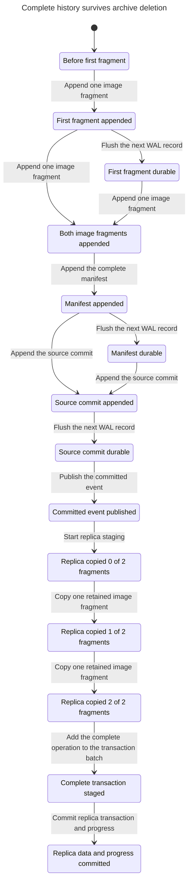
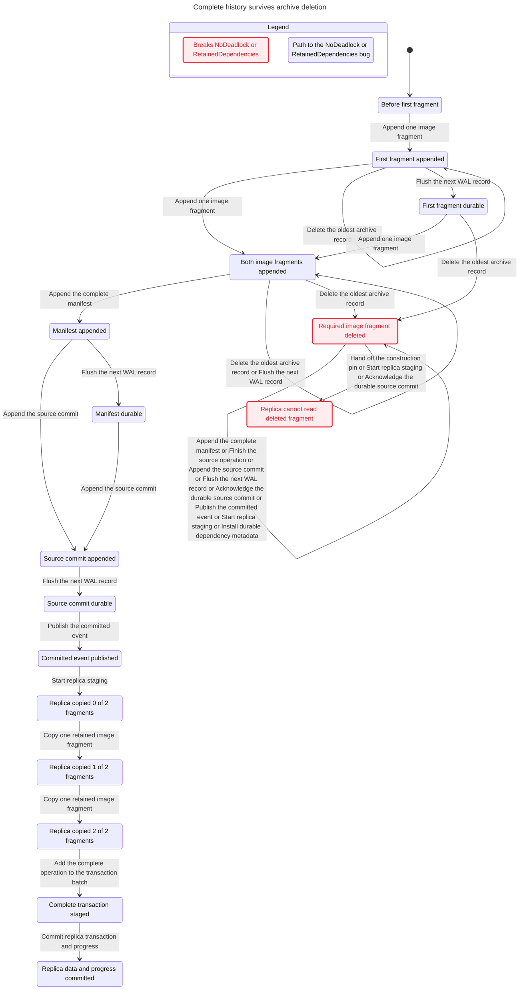

# Sidecar historical image protocol coverage

This model helps the Sidecar designer reject incomplete, cancelled, lost, or
repeated logical history before engine implementation. A reader gets the exact
committed, uncancelled image. A lagging registered reader keeps its required
WAL. A replica commits every staged operation of a source transaction and its
progress together, so a crash
cannot turn a retry into a second application.

These are finite protocol checks. They do not prove CUBRID engine conformance
or correctness for arbitrary bounds.

## Evidence and design correspondence

The source context is CUBRID commit
`e64a04a79a5842827a124b3f8313516d0da2594c`. The proposal is documentation commit
`12b1d0d20a0669ff0401c8290e672d65198aaf0d`, in
`/home/vimkim/gh/my-cubrid-docs-sidecar-codex/sidecar/codex-20261104/`.
The inputs were `design.md`, `grounding.md`, and `review.md` in that directory.

| Design section | Model correspondence |
| --- | --- |
| Durable data and module ownership | Stable operation IDs and exact before/after fragment tuples. |
| One owner defines retirement | The source supplies immutable complete images before live-chunk retirement. Physical source mutation and its undo are imported obligations. |
| Historical values are independent of live chunks | Ordered fragment, manifest, cancellation, commit, and abort WAL records. All decoder reads require retained WAL positions. |
| First-fragment pin and durable dependency handoff | `AppendFragment`, `InstallManifestMetadata`, and `ReleaseConstructionPin` are separate boundaries. |
| Savepoint rollback filtering | `BeginRollback`, `AppendCancel`, and subsequent operation admission are separate actions. Commit does not erase cancellation. |
| Archive retention and restart | Prefix deletion checks current pins. Recovery reconstructs pins and manifest metadata record by record before deletion resumes. |
| Replica apply and progress | Fragment staging and transaction-batch assembly precede the atomic `CommitReplica` boundary. Both sides of commit admit a crash. |

The grounding document describes the baseline HA target-LSA decoder and the
existing `repl_log_abort_after_lsa` bookkeeping. The current checkout still
contains that function at `src/transaction/replication.c:747`. None of the
Sidecar history records or guards in this model are claimed to exist in the
engine. The proposal permits either existing rollback-aware bookkeeping or
explicit cancellation. This model chooses explicit cancellation.

## State and exact image representation

`Token(o, p)` is a four-field tuple containing operation ID, before/after side,
ordinal within that side, and an abstract logical value. `Parts` counts
fragments on each side, so one complete image contains `2 * Parts` distinct
tokens. A manifest names every exact pair `<<operation, part>>` and its first
fragment LSA. Completeness compares stored fragment fields and payloads directly with the
independent canonical `Token` image. It never calls the `Fragment` writer
constructor. `Token` and `Image` are fixed expected inputs; writer and decoder
operators can be faulty without changing that oracle. There is no
unconstrained complete flag.

Operation IDs are `1..MaxOps` in one source transaction. The savepoint is
immediately before operation `RollbackAt`. That one operation is cancelled
before the next operation starts. With `RollbackAt = 1`, operation 2 has
before-value 0 and after-value 2. Operation 1's temporary value never enters
the expected committed stream.

| Variable | Owner and meaning |
| --- | --- |
| `wal` | Ordered appended records, including the volatile suffix. Deleted prefix contents remain as an oracle for invariants. Runtime decoder actions check that the selected record is above `archive`. |
| `durable` | Last durable WAL position. Flush advances it by one record. |
| `archive` | Last deleted WAL position. Position 1 is unrelated padding, which permits a real deletion while construction remains active. |
| `source` | Writer/recovery mode, operation and fragment cursors, rollback/commit phase, replay cursor, crash count, and externally observed acknowledgement. |
| `pins` | Volatile first-fragment construction pins, including pins for cancelled operations until the transaction dependency interval can expire. |
| `installed` | Volatile retention metadata reconstructed from durable manifests. Each entry points back to its first fragment. |
| `scan` | Committed-history enumerator position. It visits every operation ID, including cancellations. This historical reader is independent of the model's source and replica process crashes. |
| `events` | Stable logical events already enumerated, in source operation order. This is a logical stream, not a network delivery queue. |
| `history` | Each non-replica reader owns a selected operation, a staged sequence copied one retained fragment at a time, and the actual image records already delivered. |
| `offsets` | Durable positions of all registered consumers. Reader 1 is the replica. Other readers model lagging CDC or flashback consumers. |
| `replica` | Volatile per-operation image, complete transaction batch, and retry state; durable applied image records, local mode, bounded crash count, and last-crash witness. |
| `witnesses` | Observation-only flags for archive deletion during construction and after restart with durable committed history still needed. |

`AvailableCancels` reads retained cancellation records. `DurableCancels` is an
oracle over the original durable prefix. Their distinction makes loss of a
cancellation marker observable rather than silently consulting deleted WAL.
The historical enumerator retains dependencies until `scan > MaxOps`, even
if consumers have already caught up with the currently exposed prefix.

## Atomic boundaries

| Action | One transition means |
| --- | --- |
| `AppendFragment` | Append one atomic fragment record and, for the first fragment, register its construction pin under the same serialized boundary. |
| `AppendManifest` | Append one descriptor after every required fragment exists. It does not flush WAL or install durable retention metadata. |
| `BeginRollback` | Enter rollback processing for one operation. No WAL marker is appended by this step. |
| `AppendCancel` | Append one operation cancellation record. Actual source-row undo belongs to the imported mutation protocol. |
| `AdvanceOperation` | Finish the cancelled or successful operation and admit the next operation or source commit. |
| `AppendCommit` | Append one source transaction commit record. The transaction's prior work remains separate transitions. |
| `FlushPrefix` | Persist the next complete WAL record. It does not acknowledge the transaction. |
| `Acknowledge` | Record a client-visible acknowledgement after the commit is durable. |
| `InstallManifestMetadata` | Make a durable manifest's dependencies available to the retention calculation. |
| `ReleaseConstructionPin` | Remove one construction pin only after the installed metadata protects it. |
| `DeleteArchivePrefix` | Check the current retention floor and delete one oldest archive record atomically with respect to pin registration. Every real deletion path must implement or refine this serialization. |
| `SourceCrash` | Discard the volatile WAL suffix and volatile pins/metadata. Preserve the durable prefix and externally observed acknowledgement. |
| `BeginRecovery` | Start replay at the first retained record. |
| `ReplayRecord` | Read one retained durable record and reconstruct its pin or manifest metadata. |
| `FinishRecovery` | Reopen archive deletion after replay. A durable source commit survives; otherwise the source transaction enters abort. |
| `AppendAbort`, `FinishAbort` | Append abort separately from its flush and completion. Recovery cleanup remains available after the operation admission bound. |
| `RetireMetadata` | Release retention metadata only after source abort is durable, or enumeration and every consumer have finished. |
| `ExposeEvent` | Inspect one operation's retained cancellation metadata, skip cancellation or append that operation's logical event, and advance the historical reader's cursor. |
| `BeginHistoryRead(c)` | Select one committed event for a non-replica reader. |
| `ReadHistoryFragment(c)` | Copy one actual retained payload into that reader's staging sequence. The shared decoder chooses the source fragment ordinal. |
| `ReadHistory(c)` | Deliver the actual reconstructed image record and advance that reader's durable position together. |
| `BeginReplica`, `DecodeFragment` | Wait for complete committed-event enumeration, select the next event, then copy one retained fragment per step into volatile staging. |
| `StageOperation` | Append one complete operation image to the volatile transaction batch, then stage the next operation or mark the batch ready. |
| `CommitReplica` | Commit every uncancelled source operation in the assembled batch and its source progress in one local transaction. This is the selected atomicity requirement, not a proof about engine commit code. |
| `SaveReplicaProgress` | Complete the deliberately split local commit in one unsafe control. It is unreachable under `Fault = "none"`. |
| `ReplicaCrash`, `RestartReplica` | Lose staging and restart. Safe durable data and progress survive together. |
| `Done` | Stutter only after the source is finished, its WAL is durable, all history is consumed or aborted, the replica is ready, and retention metadata is empty. |

The replica stages all surviving source operations before any becomes durable.
`ReplicaTransactionAtomic` forbids durable visibility of a proper subset of
this source transaction. `SafeBatch.cfg` and `Qualification.cfg` exercise two
surviving operations after one savepoint cancellation.

## Exported properties and imported obligations

| Export | Promise | Targeted unsafe control |
| --- | --- | --- |
| `HistoryImagesComplete` | Every appended manifest describes the exact complete before/after image, and exposed events are a committed, uncancelled ordered prefix. | `publish_incomplete`, `ignore_cancel`, and cancellation-marker loss. |
| `HistoryReadExact` | Every reader's delivered image records and progress form an exact canonical committed prefix. Reader 1 uses actual durable replica data; other readers use actual delivered reconstruction results. | `writer_swapped`, `decoder_swapped`, `decoder_missing`, and `decoder_reordered`. |
| `DurableAcknowledgement` | An acknowledged source commit remains in the durable prefix. | `acknowledge_early`. |
| `RetainedDependencies` | Every record in a still-needed transaction dependency interval remains retained. | `pin_late`, `handoff_early`, `restart_unprotected`, `manifest_watermark`. |
| `CancellationMetadataRetained` | A pending historical reader cannot lose the durable cancellation evidence. | `cancel_watermark`. |
| `ReplicaCommittedPrefix` | Durable replica images and progress agree and equal an exact prefix of committed, uncancelled operations. | `split_replica_commit`. |
| `ReplicaAtMostOnce` | Each source operation appears in durable replica data at most once. | `forget_replica_progress`, followed by restart and retry. |
| `ReplicaTransactionAtomic` | Durable replica data contains none or all of the source transaction. Exact image contents and order are checked separately by `ReplicaCommittedPrefix`. | `partial_transaction_commit` stops staging after the first of two surviving operations. |
| `EventuallyDrained` | Once committed history has an exposed event, every registered consumer eventually catches up. | `decoder_livelock`, a fair two-state active loop. |

`TypeOK` is an auxiliary structural check. It types WAL payloads, exact
manifest references, staged token sequences, replica image records, cursors,
phases, witnesses, and admission budgets. It is not counted as a semantic
control. Partial or reordered decoded token sequences remain representable as
structural values. `HistoryReadExact` rejects them semantically at delivery.
This keeps missing-image controls from failing only a structural type check.

The imports are complete immutable source values, atomic record append,
ordered durable-prefix flushing, whole-record crash survival, serializable
archive guard/deletion, stable operation identities, fixed reader membership,
and atomic durable consumer positions. The historical stream enumerator's
crash is outside this model. A source writer crash does not erase that
independent reader's stable enumeration cursor or previously enumerated
logical stream. Transmission duplication and reordering are not modeled.
Replica crash/retry is modeled directly. Non-replica reader crashes are not
modeled. Their lag and partial decoding can interleave with source recovery,
archive deletion, and replica crashes.

`CommitReplica` is a proposed contract exported as a required boundary for
an implementation. The safe check assumes that boundary is atomic and the
unsafe control demonstrates the consequence of splitting it. The check does
not establish actual CUBRID transaction integration, page writes, or local
Sidecar allocation.

An integration model can import these exact predicates with a TLA+
`INSTANCE`, provided it supplies every variable above. Mapping `scan` to
`MaxOps + 1` abstracts event discovery as already complete. Such a mapping
must independently preserve complete cancellation filtering and retention
until every mapped consumer passes. This focused model does not prove that
an arbitrary caller implements those assumptions. With one registered reader,
`history` is an empty-domain function, but `HistoryReadExact` still checks
reader 1 through actual `replica.data` and `offsets[1]`.

## Cancellation dependency correction

The proposal requires every manifest dependency to remain available, but does
not explicitly enumerate rollback-cancellation records in that closure.
The unsafe `cancel_watermark` interpretation keeps only surviving operations'
fragment pins after commit. It preserves the surviving image while deleting
the earlier cancellation evidence. The safe protocol retains the whole source
transaction dependency interval until enumeration and all consumers pass.
This is a design clarification backed by a counterexample, not a discovered
CUBRID engine defect.

The retained short trace has these WAL positions:

| LSA | Record |
| --- | --- |
| 1 | Unrelated padding. |
| 2, 3 | Operation 1 before and after fragments. |
| 4 | Operation 1 manifest. |
| 5 | Cancellation of operation 1 after rollback begins. |
| 6, 7 | Operation 2 before and after fragments. |
| 8 | Operation 2 manifest. |
| 9 | Source transaction commit. |

The control performs the following distinct steps:

1. Append operation 1's fragments and manifest, begin rollback, and append its cancellation.
2. Admit operation 2, append its fragments and manifest, and append the transaction commit.
3. Flush each WAL record through LSA 9.
4. Under the faulty watermark, delete positions 1 through 5 one at a time. Operation 2's first fragment at LSA 6 remains retained.
5. State 25 violates `CancellationMetadataRetained` with `archive = 5`, `durable = 9`, `scan = 1`, and no exposed events.
6. In the publication control, state 26 enumerates operation 1 from missing cancellation evidence. `events = <<1>>` violates `HistoryImagesComplete`; the correct stream is `<<2>>`.

The original prototype also had a model bookkeeping deadlock. After recovery
of an already acknowledged commit, it waited for a second acknowledgement.
`FinishRecovery` now restores the done phase when that external observation
already exists. This changes model bookkeeping only. A second bookkeeping
correction added the bounded enumeration cursor so the stream does not reopen
and reinterpret intentionally expired history after enumeration completes.
Neither correction weakens a semantic invariant.

A required coverage repair replaced per-operation replica commits with staged
transaction-batch commit. The earlier abstraction could not express partial
visibility of a multi-operation source transaction. The final model adds
`ReplicaTransactionAtomic`, a same-property partial-transaction control, and
a witness with operations 2 and 3 committed together after operation 1 is
cancelled. The partial-commit control checks `ReplicaCommittedPrefix` and
`ReplicaAtMostOnce` alongside the atomicity property. State 35 commits only
operation 2 and advances progress to 1; the expected transaction contains
operations 2 and 3. Only `ReplicaTransactionAtomic` fails on that step.
All earlier counts are superseded by the final table below.

## Independent image oracle and delivered history

An adversarial review changed only the `Fragment` writer constructor to swap
before and after bytes. Canonical `Token` and `Image` inputs were unchanged.
The earlier `ManifestComplete` called that same writer constructor, so the
check repeated the producer's error. The earlier non-replica `ReadHistory`
advanced its cursor without recording decoded values. These were verification
gaps, not established defects in CUBRID.

The repaired `ManifestComplete` compares each stored kind, operation, ordinal,
payload, reference set, and first-position field directly with independent
expected values. Every non-replica reader now copies actual fragments into a
staging sequence and records the exact delivered image. `ReaderResults(c)`
uses those observations for readers after 1 and actual durable replica data
for reader 1. `HistoryReadExact` compares every result with canonical `Image`.

The controlled writer changes only the encoded payload. The swapped decoder
reads the opposite image side, the reordered decoder reads the fragment
sequence backward, and the missing decoder delivers one fewer fragment.
`Parts = 2` makes the swapped and reversed sequences distinct. Each reader
control violates `HistoryReadExact`, including a writer control that disables
only earlier producer semantic checks so the malformed output reaches a
consumer. `WitnessHistoryReader.cfg` reaches a non-replica reader's actual
complete four-fragment result.

The original direct-constructor attack was also reapplied outside `Fault` in
a scratch copy of the final model. It keeps `Fault = "none"`, uses bounds
`1/1/0/0/0/2`, and replaces only the writer with:

```tla
Fragment(o, p) == Record("fragment", o, p,
                         Token(o, IF p <= Parts THEN p + Parts ELSE p - Parts), {}, 0)
```

With the complete final safe property set, `HistoryImagesComplete` fails at
the first manifest after 8 distinct states. A diagnostic run with `TypeOK`
and `HistoryReadExact` reaches 178 distinct states and fails when consumer 2
executes `ReadHistory` at trace state 15. The stored result contains swapped
bytes. These runs detect both the original producer mutation and its actual
historical consumer consequence without changing the expected input.

The exact commands ran from
`/tmp/sidecar-history-20261104/adversary-final`:

```sh
java -Djava.io.tmpdir=/tmp/sidecar-history-20261104/adversary-final/java-all -XX:+UseParallelGC -Xmx2g -cp /home/vimkim/.cache/tlaplus/tla2tools-1.7.4.jar tlc2.TLC -workers 1 -metadir /tmp/sidecar-history-20261104/adversary-final/states-all -config AllChecks.cfg SidecarHistory.tla > /tmp/sidecar-history-20261104/adversary-final/all.log 2>&1
java -Djava.io.tmpdir=/tmp/sidecar-history-20261104/adversary-final/java-reader -XX:+UseParallelGC -Xmx2g -cp /home/vimkim/.cache/tlaplus/tla2tools-1.7.4.jar tlc2.TLC -workers 1 -metadir /tmp/sidecar-history-20261104/adversary-final/states-reader -config ReaderChecks.cfg SidecarHistory.tla > /tmp/sidecar-history-20261104/adversary-final/reader.log 2>&1
```

## Fairness, liveness, and reachable schedules

`Spec` contains weak fairness for source append, cancellation, commit, flush,
acknowledgement, recovery, abort, event enumeration, every reader's begin,
fragment-copy, and delivery actions,
and replica staging, commit, and restart actions. The constants bound new
source and replica crashes. Thus crashes cannot prevent availability forever.
Durable storage, decoding, and registered readers remain available and obey
those fairness premises. Archive deletion is optional. Metadata retirement is
not fair, so the model makes no temporal promise that archive cleanup finishes.

`EventuallyDrained` is the leads-to formula
`(DurableCommit /\ Len(events) > 0) ~> AllReadersDone`.
The safe cases check it over the complete graph with no symmetry, constraint,
action constraint, depth limit, or simulation. `WitnessLiveness.cfg` violates
`NoDrainAntecedent`, which proves that the antecedent is reachable.

`UnsafeFairLivelock.cfg` configures only `EventuallyDrained` as a temporal
property. Its decoder performs a real pulse transition but never adds the
next available fragment. TLC completes the 143-state graph and reports a
temporal violation. The counterexample has entered replica staging before state 17.
`DecodeFragment` changes the pulse at state 18, then returns to state 17. `DecodeFragment`
continues to run, satisfying its weak fairness. Commit is never enabled.
This control is a fair active loop, not a parser error, timeout, or deadlock.

The named negated-witness invariants establish rollback followed by source
commit, multiple fragments in a fully staged image, archive deletion during
construction, archive deletion after pin reconstruction with a committed
consumer still behind, and replica crashes immediately before and after
local commit. `WitnessTransactionBatch.cfg` also reaches a committed replica
batch containing two surviving operations. Witness failures are successful reachability checks, not safe
model failures.

## Exact bounds and completed checks

The column `O/P/R/S/C/N` gives `MaxOps`, `Parts`, `RollbackAt`, `SourceCrashes`,
`ReplicaCrashes`, and `Consumers`, in that order. `Parts` is per image side.
These are admission bounds; they never disable recovery or cleanup.
`Qualification.cfg` expands to three operations and four total image
fragments. There is no claim that separate small cases prove their unbounded
union.

Every listed case ran against the final module with the release 1.7.4 jar.
Its SHA-256 is
`936a262061c914694dfd669a543be24573c45d5aa0ff20a8b96b23d01e050e88`.
The embedded TLC banner is `TLC2 Version 2.19 of 08 August 2024`.
Safe runs exited 0 with an empty queue. Named invariant controls and witnesses
exited 12. The fair-livelock control exited 13. Each negative case reported
its intended property. No tool failure counts as a successful control. The enlarged reader-state
model uses explicit 300-second quick-case and 600-second qualification wall
budgets. These replaced the earlier 120/240-second execution budgets without
changing a numeric protocol bound. The final qualification finished in
316 seconds, below its budget.

| Case | Config | O/P/R/S/C/N | Generated | Distinct | Result |
| --- | --- | --- | ---: | ---: | --- |
| `safe` | `Safe.cfg` | 2/1/1/1/1/2 | 67978 | 18805 | Complete |
| `safe_decode` | `SafeDecode.cfg` | 1/2/0/0/0/2 | 3626 | 1172 | Complete |
| `unsafe_writer` | `UnsafeWriter.cfg` | 1/2/0/0/0/2 | 29 | 21 | HistoryImagesComplete |
| `unsafe_writer_reader` | `UnsafeWriterReader.cfg` | 1/2/0/0/0/2 | 880 | 365 | HistoryReadExact |
| `unsafe_decoder_swapped` | `UnsafeDecoderSwapped.cfg` | 1/2/0/0/0/2 | 880 | 365 | HistoryReadExact |
| `unsafe_decoder_missing` | `UnsafeDecoderMissing.cfg` | 1/2/0/0/0/2 | 648 | 285 | HistoryReadExact |
| `unsafe_decoder_reordered` | `UnsafeDecoderReordered.cfg` | 1/2/0/0/0/2 | 880 | 365 | HistoryReadExact |
| `witness_history_reader` | `WitnessHistoryReader.cfg` | 1/2/0/0/0/2 | 880 | 365 | NoHistoryReaderResult |
| `safe_batch` | `SafeBatch.cfg` | 3/1/1/1/1/2 | 457646 | 98248 | Complete |
| `unsafe_partial_transaction` | `UnsafePartialTransaction.cfg` | 3/1/1/1/1/2 | 16664 | 5633 | ReplicaTransactionAtomic |
| `witness_transaction_batch` | `WitnessTransactionBatch.cfg` | 3/1/1/1/1/2 | 33767 | 9487 | NoTwoOperationReplicaCommit |
| `chart_safe` | `ChartSafe.cfg` | 1/1/0/0/0/1 | 511 | 219 | Complete |
| `chart_unsafe` | `ChartUnsafe.cfg` | 1/1/0/0/0/1 | 26 | 20 | RetainedDependencies |
| `unsafe_cancel_dependency` | `UnsafeCancelDependency.cfg` | 2/1/1/1/1/2 | 3845 | 1717 | CancellationMetadataRetained |
| `unsafe_cancel_after_prune` | `UnsafeCancelAfterPrune.cfg` | 2/1/1/1/1/2 | 4733 | 2019 | HistoryImagesComplete |
| `qualification` | `Qualification.cfg` | 3/2/1/1/1/2 | 979811 | 216142 | Complete |
| `unsafe_incomplete_image` | `UnsafeIncompleteImage.cfg` | 2/1/1/1/1/2 | 6 | 6 | HistoryImagesComplete |
| `unsafe_cancelled_history` | `UnsafeCancelledHistory.cfg` | 2/1/1/1/1/2 | 2239 | 1124 | HistoryImagesComplete |
| `unsafe_early_ack` | `UnsafeEarlyAck.cfg` | 2/1/1/1/1/2 | 597 | 357 | DurableAcknowledgement |
| `unsafe_first_pin` | `UnsafeFirstPin.cfg` | 2/1/1/1/1/2 | 41 | 34 | RetainedDependencies |
| `unsafe_handoff` | `UnsafeHandoff.cfg` | 2/1/1/1/1/2 | 214 | 125 | RetainedDependencies |
| `unsafe_restart` | `UnsafeRestart.cfg` | 2/1/1/1/1/2 | 96 | 62 | RetainedDependencies |
| `unsafe_manifest_watermark` | `UnsafeManifestWatermark.cfg` | 2/1/1/1/1/2 | 420 | 257 | RetainedDependencies |
| `unsafe_replica_atomicity` | `UnsafeReplicaAtomicity.cfg` | 2/1/1/1/1/2 | 5281 | 2190 | ReplicaCommittedPrefix |
| `unsafe_replica_retry` | `UnsafeReplicaRetry.cfg` | 2/1/1/1/1/2 | 29393 | 8426 | ReplicaAtMostOnce |
| `unsafe_fair_livelock` | `UnsafeFairLivelock.cfg` | 1/1/0/0/0/1 | 336 | 143 | EventuallyDrained |
| `witness_liveness` | `WitnessLiveness.cfg` | 2/1/1/1/1/2 | 2532 | 1242 | NoDrainAntecedent |
| `witness_rollback_commit` | `WitnessRollbackCommit.cfg` | 2/1/1/1/1/2 | 2532 | 1242 | NoRollbackCommit |
| `witness_fragments` | `WitnessFragments.cfg` | 2/2/1/1/1/2 | 8950 | 4282 | NoMultipleFragments |
| `witness_archive_construction` | `WitnessArchiveConstruction.cfg` | 2/1/1/1/1/2 | 7 | 7 | NoArchiveDuringConstruction |
| `witness_archive_restart` | `WitnessArchiveRestart.cfg` | 2/1/1/1/1/2 | 23696 | 6934 | NoArchiveAfterRestart |
| `witness_replica_crash_before` | `WitnessReplicaCrashBefore.cfg` | 2/1/1/1/1/2 | 5282 | 2191 | NoReplicaCrashBeforeCommit |
| `witness_replica_crash_after` | `WitnessReplicaCrashAfter.cfg` | 2/1/1/1/1/2 | 6761 | 2622 | NoReplicaCrashAfterCommit |

The final quick safe graph has depth 60. The batch safe graph has depth 84.
The decoder safe graph has depth 37. The qualification graph has depth 120. These are reported completed-graph depths, not configured cutoffs.

## Exact TLC commands

The following commands were executed from this model directory. Each JVM
has its own temporary directory, so concurrent standard-module extraction
cannot race. The temporary output directories are evidence from this run;
the model, configs, bounds, and properties are the retained reproduction
inputs. A fresh run may choose fresh temporary paths without changing the
state space.

```sh
java -Djava.io.tmpdir=/tmp/sidecar-history-20261104/java-safe -XX:+UseParallelGC -Xmx2g -cp /home/vimkim/.cache/tlaplus/tla2tools-1.7.4.jar tlc2.TLC -workers 1 -metadir /tmp/sidecar-history-20261104/states-safe -config Safe.cfg SidecarHistory.tla > /tmp/sidecar-history-20261104/safe.log 2>&1
java -Djava.io.tmpdir=/tmp/sidecar-history-20261104/java-safe_decode -XX:+UseParallelGC -Xmx2g -cp /home/vimkim/.cache/tlaplus/tla2tools-1.7.4.jar tlc2.TLC -workers 1 -metadir /tmp/sidecar-history-20261104/states-safe_decode -config SafeDecode.cfg SidecarHistory.tla > /tmp/sidecar-history-20261104/safe_decode.log 2>&1
java -Djava.io.tmpdir=/tmp/sidecar-history-20261104/java-unsafe_writer -XX:+UseParallelGC -Xmx2g -cp /home/vimkim/.cache/tlaplus/tla2tools-1.7.4.jar tlc2.TLC -workers 1 -metadir /tmp/sidecar-history-20261104/states-unsafe_writer -config UnsafeWriter.cfg SidecarHistory.tla > /tmp/sidecar-history-20261104/unsafe_writer.log 2>&1
java -Djava.io.tmpdir=/tmp/sidecar-history-20261104/java-unsafe_writer_reader -XX:+UseParallelGC -Xmx2g -cp /home/vimkim/.cache/tlaplus/tla2tools-1.7.4.jar tlc2.TLC -workers 1 -metadir /tmp/sidecar-history-20261104/states-unsafe_writer_reader -config UnsafeWriterReader.cfg SidecarHistory.tla > /tmp/sidecar-history-20261104/unsafe_writer_reader.log 2>&1
java -Djava.io.tmpdir=/tmp/sidecar-history-20261104/java-unsafe_decoder_swapped -XX:+UseParallelGC -Xmx2g -cp /home/vimkim/.cache/tlaplus/tla2tools-1.7.4.jar tlc2.TLC -workers 1 -metadir /tmp/sidecar-history-20261104/states-unsafe_decoder_swapped -config UnsafeDecoderSwapped.cfg SidecarHistory.tla > /tmp/sidecar-history-20261104/unsafe_decoder_swapped.log 2>&1
java -Djava.io.tmpdir=/tmp/sidecar-history-20261104/java-unsafe_decoder_missing -XX:+UseParallelGC -Xmx2g -cp /home/vimkim/.cache/tlaplus/tla2tools-1.7.4.jar tlc2.TLC -workers 1 -metadir /tmp/sidecar-history-20261104/states-unsafe_decoder_missing -config UnsafeDecoderMissing.cfg SidecarHistory.tla > /tmp/sidecar-history-20261104/unsafe_decoder_missing.log 2>&1
java -Djava.io.tmpdir=/tmp/sidecar-history-20261104/java-unsafe_decoder_reordered -XX:+UseParallelGC -Xmx2g -cp /home/vimkim/.cache/tlaplus/tla2tools-1.7.4.jar tlc2.TLC -workers 1 -metadir /tmp/sidecar-history-20261104/states-unsafe_decoder_reordered -config UnsafeDecoderReordered.cfg SidecarHistory.tla > /tmp/sidecar-history-20261104/unsafe_decoder_reordered.log 2>&1
java -Djava.io.tmpdir=/tmp/sidecar-history-20261104/java-witness_history_reader -XX:+UseParallelGC -Xmx2g -cp /home/vimkim/.cache/tlaplus/tla2tools-1.7.4.jar tlc2.TLC -workers 1 -metadir /tmp/sidecar-history-20261104/states-witness_history_reader -config WitnessHistoryReader.cfg SidecarHistory.tla > /tmp/sidecar-history-20261104/witness_history_reader.log 2>&1
java -Djava.io.tmpdir=/tmp/sidecar-history-20261104/java-safe_batch -XX:+UseParallelGC -Xmx2g -cp /home/vimkim/.cache/tlaplus/tla2tools-1.7.4.jar tlc2.TLC -workers 1 -metadir /tmp/sidecar-history-20261104/states-safe_batch -config SafeBatch.cfg SidecarHistory.tla > /tmp/sidecar-history-20261104/safe_batch.log 2>&1
java -Djava.io.tmpdir=/tmp/sidecar-history-20261104/java-unsafe_partial_transaction -XX:+UseParallelGC -Xmx2g -cp /home/vimkim/.cache/tlaplus/tla2tools-1.7.4.jar tlc2.TLC -workers 1 -metadir /tmp/sidecar-history-20261104/states-unsafe_partial_transaction -config UnsafePartialTransaction.cfg SidecarHistory.tla > /tmp/sidecar-history-20261104/unsafe_partial_transaction.log 2>&1
java -Djava.io.tmpdir=/tmp/sidecar-history-20261104/java-witness_transaction_batch -XX:+UseParallelGC -Xmx2g -cp /home/vimkim/.cache/tlaplus/tla2tools-1.7.4.jar tlc2.TLC -workers 1 -metadir /tmp/sidecar-history-20261104/states-witness_transaction_batch -config WitnessTransactionBatch.cfg SidecarHistory.tla > /tmp/sidecar-history-20261104/witness_transaction_batch.log 2>&1
java -Djava.io.tmpdir=/tmp/sidecar-history-20261104/java-chart_safe -XX:+UseParallelGC -Xmx2g -cp /home/vimkim/.cache/tlaplus/tla2tools-1.7.4.jar tlc2.TLC -workers 1 -metadir /tmp/sidecar-history-20261104/states-chart_safe -config ChartSafe.cfg SidecarHistory.tla > /tmp/sidecar-history-20261104/chart_safe.log 2>&1
java -Djava.io.tmpdir=/tmp/sidecar-history-20261104/java-chart_unsafe -XX:+UseParallelGC -Xmx2g -cp /home/vimkim/.cache/tlaplus/tla2tools-1.7.4.jar tlc2.TLC -workers 1 -metadir /tmp/sidecar-history-20261104/states-chart_unsafe -config ChartUnsafe.cfg SidecarHistory.tla > /tmp/sidecar-history-20261104/chart_unsafe.log 2>&1
java -Djava.io.tmpdir=/tmp/sidecar-history-20261104/java-unsafe_cancel_dependency -XX:+UseParallelGC -Xmx2g -cp /home/vimkim/.cache/tlaplus/tla2tools-1.7.4.jar tlc2.TLC -workers 1 -metadir /tmp/sidecar-history-20261104/states-unsafe_cancel_dependency -config UnsafeCancelDependency.cfg SidecarHistory.tla > /tmp/sidecar-history-20261104/unsafe_cancel_dependency.log 2>&1
java -Djava.io.tmpdir=/tmp/sidecar-history-20261104/java-unsafe_cancel_after_prune -XX:+UseParallelGC -Xmx2g -cp /home/vimkim/.cache/tlaplus/tla2tools-1.7.4.jar tlc2.TLC -workers 1 -metadir /tmp/sidecar-history-20261104/states-unsafe_cancel_after_prune -config UnsafeCancelAfterPrune.cfg SidecarHistory.tla > /tmp/sidecar-history-20261104/unsafe_cancel_after_prune.log 2>&1
java -Djava.io.tmpdir=/tmp/sidecar-history-20261104/java-qualification -XX:+UseParallelGC -Xmx2g -cp /home/vimkim/.cache/tlaplus/tla2tools-1.7.4.jar tlc2.TLC -workers 1 -metadir /tmp/sidecar-history-20261104/states-qualification -config Qualification.cfg SidecarHistory.tla > /tmp/sidecar-history-20261104/qualification.log 2>&1
java -Djava.io.tmpdir=/tmp/sidecar-history-20261104/java-unsafe_incomplete_image -XX:+UseParallelGC -Xmx2g -cp /home/vimkim/.cache/tlaplus/tla2tools-1.7.4.jar tlc2.TLC -workers 1 -metadir /tmp/sidecar-history-20261104/states-unsafe_incomplete_image -config UnsafeIncompleteImage.cfg SidecarHistory.tla > /tmp/sidecar-history-20261104/unsafe_incomplete_image.log 2>&1
java -Djava.io.tmpdir=/tmp/sidecar-history-20261104/java-unsafe_cancelled_history -XX:+UseParallelGC -Xmx2g -cp /home/vimkim/.cache/tlaplus/tla2tools-1.7.4.jar tlc2.TLC -workers 1 -metadir /tmp/sidecar-history-20261104/states-unsafe_cancelled_history -config UnsafeCancelledHistory.cfg SidecarHistory.tla > /tmp/sidecar-history-20261104/unsafe_cancelled_history.log 2>&1
java -Djava.io.tmpdir=/tmp/sidecar-history-20261104/java-unsafe_early_ack -XX:+UseParallelGC -Xmx2g -cp /home/vimkim/.cache/tlaplus/tla2tools-1.7.4.jar tlc2.TLC -workers 1 -metadir /tmp/sidecar-history-20261104/states-unsafe_early_ack -config UnsafeEarlyAck.cfg SidecarHistory.tla > /tmp/sidecar-history-20261104/unsafe_early_ack.log 2>&1
java -Djava.io.tmpdir=/tmp/sidecar-history-20261104/java-unsafe_first_pin -XX:+UseParallelGC -Xmx2g -cp /home/vimkim/.cache/tlaplus/tla2tools-1.7.4.jar tlc2.TLC -workers 1 -metadir /tmp/sidecar-history-20261104/states-unsafe_first_pin -config UnsafeFirstPin.cfg SidecarHistory.tla > /tmp/sidecar-history-20261104/unsafe_first_pin.log 2>&1
java -Djava.io.tmpdir=/tmp/sidecar-history-20261104/java-unsafe_handoff -XX:+UseParallelGC -Xmx2g -cp /home/vimkim/.cache/tlaplus/tla2tools-1.7.4.jar tlc2.TLC -workers 1 -metadir /tmp/sidecar-history-20261104/states-unsafe_handoff -config UnsafeHandoff.cfg SidecarHistory.tla > /tmp/sidecar-history-20261104/unsafe_handoff.log 2>&1
java -Djava.io.tmpdir=/tmp/sidecar-history-20261104/java-unsafe_restart -XX:+UseParallelGC -Xmx2g -cp /home/vimkim/.cache/tlaplus/tla2tools-1.7.4.jar tlc2.TLC -workers 1 -metadir /tmp/sidecar-history-20261104/states-unsafe_restart -config UnsafeRestart.cfg SidecarHistory.tla > /tmp/sidecar-history-20261104/unsafe_restart.log 2>&1
java -Djava.io.tmpdir=/tmp/sidecar-history-20261104/java-unsafe_manifest_watermark -XX:+UseParallelGC -Xmx2g -cp /home/vimkim/.cache/tlaplus/tla2tools-1.7.4.jar tlc2.TLC -workers 1 -metadir /tmp/sidecar-history-20261104/states-unsafe_manifest_watermark -config UnsafeManifestWatermark.cfg SidecarHistory.tla > /tmp/sidecar-history-20261104/unsafe_manifest_watermark.log 2>&1
java -Djava.io.tmpdir=/tmp/sidecar-history-20261104/java-unsafe_replica_atomicity -XX:+UseParallelGC -Xmx2g -cp /home/vimkim/.cache/tlaplus/tla2tools-1.7.4.jar tlc2.TLC -workers 1 -metadir /tmp/sidecar-history-20261104/states-unsafe_replica_atomicity -config UnsafeReplicaAtomicity.cfg SidecarHistory.tla > /tmp/sidecar-history-20261104/unsafe_replica_atomicity.log 2>&1
java -Djava.io.tmpdir=/tmp/sidecar-history-20261104/java-unsafe_replica_retry -XX:+UseParallelGC -Xmx2g -cp /home/vimkim/.cache/tlaplus/tla2tools-1.7.4.jar tlc2.TLC -workers 1 -metadir /tmp/sidecar-history-20261104/states-unsafe_replica_retry -config UnsafeReplicaRetry.cfg SidecarHistory.tla > /tmp/sidecar-history-20261104/unsafe_replica_retry.log 2>&1
java -Djava.io.tmpdir=/tmp/sidecar-history-20261104/java-unsafe_fair_livelock -XX:+UseParallelGC -Xmx2g -cp /home/vimkim/.cache/tlaplus/tla2tools-1.7.4.jar tlc2.TLC -workers 1 -metadir /tmp/sidecar-history-20261104/states-unsafe_fair_livelock -config UnsafeFairLivelock.cfg SidecarHistory.tla > /tmp/sidecar-history-20261104/unsafe_fair_livelock.log 2>&1
java -Djava.io.tmpdir=/tmp/sidecar-history-20261104/java-witness_liveness -XX:+UseParallelGC -Xmx2g -cp /home/vimkim/.cache/tlaplus/tla2tools-1.7.4.jar tlc2.TLC -workers 1 -metadir /tmp/sidecar-history-20261104/states-witness_liveness -config WitnessLiveness.cfg SidecarHistory.tla > /tmp/sidecar-history-20261104/witness_liveness.log 2>&1
java -Djava.io.tmpdir=/tmp/sidecar-history-20261104/java-witness_rollback_commit -XX:+UseParallelGC -Xmx2g -cp /home/vimkim/.cache/tlaplus/tla2tools-1.7.4.jar tlc2.TLC -workers 1 -metadir /tmp/sidecar-history-20261104/states-witness_rollback_commit -config WitnessRollbackCommit.cfg SidecarHistory.tla > /tmp/sidecar-history-20261104/witness_rollback_commit.log 2>&1
java -Djava.io.tmpdir=/tmp/sidecar-history-20261104/java-witness_fragments -XX:+UseParallelGC -Xmx2g -cp /home/vimkim/.cache/tlaplus/tla2tools-1.7.4.jar tlc2.TLC -workers 1 -metadir /tmp/sidecar-history-20261104/states-witness_fragments -config WitnessFragments.cfg SidecarHistory.tla > /tmp/sidecar-history-20261104/witness_fragments.log 2>&1
java -Djava.io.tmpdir=/tmp/sidecar-history-20261104/java-witness_archive_construction -XX:+UseParallelGC -Xmx2g -cp /home/vimkim/.cache/tlaplus/tla2tools-1.7.4.jar tlc2.TLC -workers 1 -metadir /tmp/sidecar-history-20261104/states-witness_archive_construction -config WitnessArchiveConstruction.cfg SidecarHistory.tla > /tmp/sidecar-history-20261104/witness_archive_construction.log 2>&1
java -Djava.io.tmpdir=/tmp/sidecar-history-20261104/java-witness_archive_restart -XX:+UseParallelGC -Xmx2g -cp /home/vimkim/.cache/tlaplus/tla2tools-1.7.4.jar tlc2.TLC -workers 1 -metadir /tmp/sidecar-history-20261104/states-witness_archive_restart -config WitnessArchiveRestart.cfg SidecarHistory.tla > /tmp/sidecar-history-20261104/witness_archive_restart.log 2>&1
java -Djava.io.tmpdir=/tmp/sidecar-history-20261104/java-witness_replica_crash_before -XX:+UseParallelGC -Xmx2g -cp /home/vimkim/.cache/tlaplus/tla2tools-1.7.4.jar tlc2.TLC -workers 1 -metadir /tmp/sidecar-history-20261104/states-witness_replica_crash_before -config WitnessReplicaCrashBefore.cfg SidecarHistory.tla > /tmp/sidecar-history-20261104/witness_replica_crash_before.log 2>&1
java -Djava.io.tmpdir=/tmp/sidecar-history-20261104/java-witness_replica_crash_after -XX:+UseParallelGC -Xmx2g -cp /home/vimkim/.cache/tlaplus/tla2tools-1.7.4.jar tlc2.TLC -workers 1 -metadir /tmp/sidecar-history-20261104/states-witness_replica_crash_after -config WitnessReplicaCrashAfter.cfg SidecarHistory.tla > /tmp/sidecar-history-20261104/witness_replica_crash_after.log 2>&1
```

## Statechart interpretation

The `/statechart` skill checked the final `ChartSafe.cfg` and `ChartUnsafe.cfg`
from scratch copies. The safe report holds all configured rules, including
`EventuallyDrained` and deadlock freedom. It has 219 model states and 489
steps, rendered as 14 chart states and 15 arrows. Its view hides 328 steps
whose reader-visible label does not change.

The unsafe first-pin report explores past the first invariant failure. It
has 286 states and 612 steps. The view has 16 states and 21 arrows and hides
426 steps within the same visible state. It keeps distinct labels for an
already lost fragment and the later replica deadlock.

`RetainedDependencies` breaks on the report's shortest four-step path.
The reader's rule is that a required image fragment remains available.
Append the first fragment, delete unrelated padding, flush the first fragment,
then delete that fragment while no construction pin exists. The later
`NoDeadlock` failure is an additional consequence at report step 16, when
replica decoding cannot read that deleted fragment. It does not validate the
negative control; the named retention invariant failure does.

The safe generated chart is:



The unsafe generated chart is:



The charts were produced with `/statechart`. Read its current skill for
commands and options; its invocation is intentionally not embedded here.

For reproduction, copy the module and those two configs to a new scratch
folder, choose new output folders, and use this view module:

```javascript
const values = (x) => Object.values(x ?? {});
const has = (v, kind, durable = false) => values(v.wal).some((r, i) => r.kind === kind && (!durable || i + 1 <= v.durable));
const length = (x) => values(x).length;
export const title = 'Complete history survives archive deletion';
export function state(v) {
  const committed = has(v, 'commit', true);
  const pending = !committed || v.scan <= 1 || v.offsets[1] < 1;
  const stuck = v.source.phase === 'done' && v.durable === length(v.wal) && v.scan > 1 && v.replica.mode === 'staging' && length(v.pins) === 0 && length(v.installed) > 0;
  if (pending && v.archive >= 2) return stuck ? 'Replica cannot read deleted fragment' : 'Required image fragment deleted';
  if (length(v.replica.data)) return 'Replica data and progress committed';
  if (v.replica.mode === 'batch_ready') return 'Complete transaction staged';
  if (v.replica.mode === 'staging') return `Replica copied ${length(v.replica.staged)} of 2 fragments`;
  if (length(v.events)) return 'Committed event published';
  if (committed) return 'Source commit durable';
  if (has(v, 'commit')) return 'Source commit appended';
  if (has(v, 'manifest', true)) return 'Manifest durable';
  if (has(v, 'manifest')) return 'Manifest appended';
  const n = values(v.wal).filter(r => r.kind === 'fragment').length;
  if (n === 2) return 'Both image fragments appended';
  if (n === 1) return v.durable >= 2 ? 'First fragment durable' : 'First fragment appended';
  return 'Before first fragment';
}
const labels = {
  AppendFragment: 'Append one image fragment', AppendManifest: 'Append the complete manifest',
  AdvanceOperation: 'Finish the source operation', AppendCommit: 'Append the source commit',
  FlushPrefix: 'Flush the next WAL record', Acknowledge: 'Acknowledge the durable source commit',
  InstallManifestMetadata: 'Install durable dependency metadata', ReleaseConstructionPin: 'Hand off the construction pin',
  DeleteArchivePrefix: 'Delete the oldest archive record', ExposeEvent: 'Publish the committed event',
  BeginReplica: 'Start replica staging', DecodeFragment: 'Copy one retained image fragment',
  StageOperation: 'Add the complete operation to the transaction batch',
  CommitReplica: 'Commit replica transaction and progress', RetireMetadata: 'Release consumed history', Done: 'Complete'
};
export const step = (action) => labels[action] ?? action;
```

## Limits

The checks cover one updating source transaction, a fixed row representation,
canonical abstract values, one savepoint cancellation, finite crash budgets,
and fixed consumers. They omit simultaneous source transactions, nested
savepoints, multiple source transaction batches, network delivery
reordering, dynamically registered or disconnected consumers, byte-length
parsing, checksum collisions, torn writes, encryption, physical redo/undo,
chunk allocation, and actual CUBRID callbacks. Source crash aborts an
uncommitted transaction; it does not resume its remaining requested writes.

One archive record is one modeled deletion unit. Real archive-file boundaries
coarsen that unit. Every actual deletion path still needs the same dependency
closure and serialization with first-pin registration. No source live-heap
lookup is part of history decoding. A history request after all registered
consumers pass is outside the promised window; explicit unavailable-history
reporting is not modeled.

The source mutation protocol must prove the imported complete immutable
values and rollback identity mapping. The engine POC must prove the local
commit boundary and archive/restart integration. The statechart paths are
protocol examples because the proposed Sidecar engine code does not exist;
no engine replay or runtime reproduction is claimed.

Model the Domain shaped the ordered record types, fragment identities,
cancellation, and owned cursors. Prove It Works required complete TLC runs,
same-property unsafe controls, reachable witnesses, and the statechart
interpretation of the actual model files.

## Final common qualification receipt

The common qualification run completed all 33 history cases with their
expected verdicts. Its report is
`/mnt/nvme/data-5/tmp/sidecar-tlc-7ff52zr4/report.json`.
Report SHA-256: `8d18505c1655fd20a1b8aba36f9fbee89606a988fb47bcd0953c8944ea66e9e8`.
Safe state counts are exhausted searches; negative and witness counts are
prefixes ending at their named counterexamples. All quick cases are included.
The final run used the frozen runner and requirements, without concurrent
edits to executable inputs. The table above is reconciled with this receipt.
