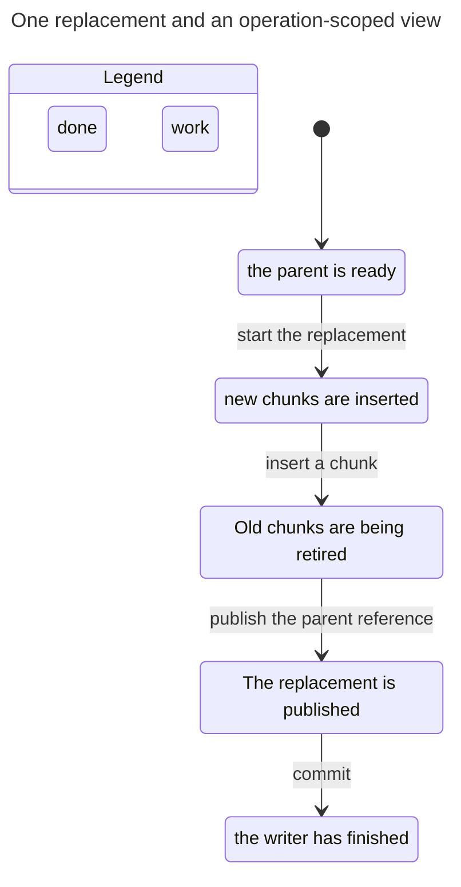
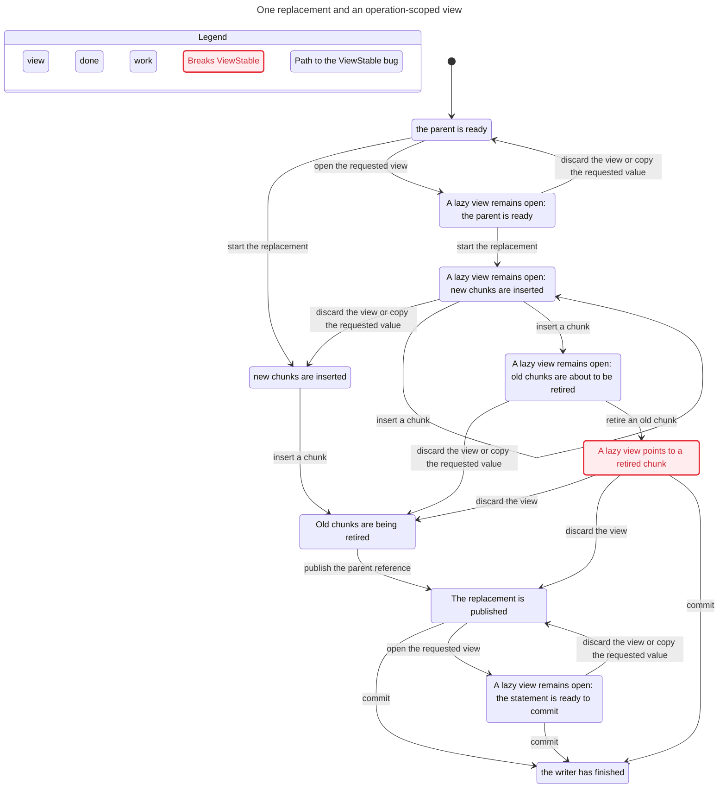

# Sidecar lifetime model

## Promise and harm

A reader that can see a parent version must see both immutable chunk parts for
that version under the same effective transaction family and snapshot. An
unchanged external value keeps its ID. Replacement uses a fresh ID. Rolling
back a statement, savepoint, or transaction restores the matching parent and
chunk effects. A competing writer cannot mutate the row while the first writer
holds its lock. An old snapshot keeps the retired value until it closes. After
all writers finish, the snapshot closes, and collection drains, every present
chunk belongs to the current parent. Committed retired chunks eventually drain
under the fairness and availability premises below.

Breaking these rules can return incomplete or wrong bytes, expose a rolled-back
value, lose an old snapshot's value, or let two writers corrupt each other's
versions. A pending lazy view cannot cross a same-transaction mutation. A copied
value remains stable after its operation-scoped view closes. Rollback and commit
invalidate a pending lazy view without requiring a successful cold read or an
allocation.

This is a proposal model, not a model of the complete CUBRID engine and not an
arbitrary-size proof. It imports the visibility and locking assumptions below.
It does not establish that CUBRID actually meets them.

## Context

The source baseline is CUBRID commit
`e64a04a79a5842827a124b3f8313516d0da2594c`. The design and its evidence are in
`/home/vimkim/gh/my-cubrid-docs-sidecar-codex/sidecar/codex-20261104/` at
docs commit `12b1d0d20a0669ff0401c8290e672d65198aaf0d`. The relevant design
sections are "Callers use rows and values" and "One owner defines retirement".
`grounding.md` separates ordinary row visibility, ownership, vacuum, and
physical reuse. `review.md` describes the independent `probes/visibility.py`
probe of baseline MVCC functions. That probe showed an own DELETE can hide a
chunk under the same snapshot. It did not establish a reachable stale
`VisibleRow` execution or prove native rollback or the proposed protocol.

The first model allowed a lazy view to survive transaction rollback. TLC found
that undoing an insertion then destroys the still-referenced chunk. That trace
violated the design's one-storage-operation view scope. It was model drift, not
a newly established design or engine defect. The corrected model invalidates
such views at rollback and commit. `RollbackRetainsView` retains the prohibited
behavior as a control. An early prototype also omitted the `Integers` import
needed for the `-1` sentinel; TLC rejected that model before exploration.

## State and atomic boundaries

There is one parent row, one external attribute, two chunk ordinals per value,
one initial committed value, at most two writers, and at most one old snapshot.
A value's payload is represented by one scalar repeated in both chunks. `NoRef`
represents the deleted row. Inline and NULL values are not modeled.

- `parents` is the sequence of physical parent versions with references and
  their root MVCC IDs. `chunks` holds each chunk's immutable data, insertion
  identity, deletion identity, and physical presence.
- `logical` is a separate shadow history of completed statement values. It is
  an oracle, not a proposed engine object. `ObservationOK` selects a physical
  parent and checks its chunks against this shadow history. Parent, child, and
  oracle effects can differ during an incomplete statement or rollback.
- `txStatus`, `commitAt`, and `clock` determine committed visibility. `Family`
  maps root IDs 1 and 2 and nested IDs 3 and 4 to their effective families.
  Parent and child records use different IDs in the same family. Neither this
  mapping nor the commit clock is claimed to be CUBRID's implementation.
- `phase`, `owner`, `admitted`, and `context` record each writer's phase, the
  exclusive parent lock, bounded statement admissions, and the current
  operation. The second writer reads the current committed row after obtaining
  the lock. `MaxOps` bounds new statements, not rollback or cleanup.
- `journal`, `stmtMark`, `saveMark`, `saveRolled`, `cancelled`, and
  `abortStarted` record individual undo effects and rollback boundaries. The
  first admitted statement establishes the modeled savepoint if it completes.
  If that statement is cancelled, there is no savepoint in that execution.
- `prefix` is verification-only state outside that journal. `Begin` captures
  the visible parent reference and logical value before a statement. `Finish`
  records the first admitted statement's intended reference and value as the
  savepoint expectation when that statement completes. `FinishUndo` selects
  which expectation to check at the restored `ready` boundary. Undo never pops
  or changes these expectations.
- `nextId` and `issued` reserve monotonically new value IDs, even on rollback.
  `snapshot` records the one old snapshot at epoch zero. `view` and `viewUsed`
  record one optional operation-scoped own view and its copied result.
  `milestones` records witness events only. `pulse` exposes the fair-livelock
  control and carries no protocol information.

The atomic actions are the following.

- `Join` registers the second writer's request. `Acquire` assigns the row lock.
  `Begin` admits one statement, reserves its ID when replacing, records the
  old reference, and closes any already materialized view. Each is one action.
- `OpenView`, `Materialize`, and `DiscardView` each act on one view. A
  successful materialization copies the actual first chunk value after both
  parts pass the completeness check. The model treats this copy as atomic and
  forbids a same-transaction mutation before a requested value is copied or
  the view is discarded.
- Each `ChunkInsert` and `ChunkDelete` changes one chunk and records the
  corresponding prior image in the journal atomically. This models the required
  recoverable effect, not a proof of the engine's logging implementation.
  `Publish` appends one parent version and its undo entry. `Finish` records one
  completed logical statement and its oracle undo entry. It also records the
  independent savepoint expectation when the first admitted statement
  completes. Other readers may observe after every one of these actions. The
  writer may observe its own row only at a `ready` statement boundary.
- `Cancel`, `StartSaveUndo`, and `StartAbort` begin separate rollback scopes.
  Each `UndoEffect` pops and reverses exactly one journal entry. `FinishUndo`
  returns to the statement boundary or releases the lock after full abort.
  At a completed statement or savepoint rollback, the saved reference, expected
  value, and both visible chunk parts must match. Savepoint rollback and
  transaction abort close a lazy view as part of starting undo. They do not wait
  for `Materialize` or allocate copied bytes.
- `Commit` makes one transaction family visible, advances the commit epoch,
  closes its view, and releases the lock in one action. `ReleaseSnapshot`
  closes the old snapshot. Each `Collect` removes one eligible chunk after its
  deleting transaction commits and the old snapshot no longer needs it.
- `Done` stutters only after all admitted writers finish, the old snapshot is
  closed, and no committed deleted chunk remains eligible for collection.
  TLC deadlock checking remains enabled.

`VisibleValueComplete` compares the shadow value with the selected physical
parent and both visible chunks. `RollbackPrefixRestored` compares the result of
statement or savepoint undo with the independent `prefix` record. The statement
snapshot records the reference and logical value at `Begin`, before any later
physical effect. The savepoint snapshot records the intended result of the
first admitted statement if it completes, independent of `saveMark` and the
journal. This comparison
also checks the shadow value and both chunk parts. `NoUnownedAfterDrain` checks
physical presence in the single-row inventory after every writer finishes, the
snapshot closes, and no committed deleted chunk remains eligible. A retained
present chunk must belong to the selected current parent. The check catches an
aborted inserted chunk even when it has no DELETE and cannot be collected.

The independent review showed that `VisibleValueComplete` alone missed an
omitted INSERT undo and a rollback target that erased the physical parent and
logical history together. The added rules catch those different faults. The
`WrongParentFamily`, `WrongFamily`, `WrongChunkData`, and `PartialUndo` controls
continue to check physical effects against the shadow history. `CorruptCopy`
checks copied bytes.

## Fairness and progress

`EventuallyAcquired` says that a waiting second writer eventually leaves the
waiting phase. `CleanupPending` means a physically present chunk has a committed
DELETE, even when a retained snapshot currently prevents collection.
`EventuallyDrained` says every state with `CleanupPending` is followed by a
state where all writers are done, the snapshot is closed, and no eligible
chunk remains. At that state every remaining committed deletion would be
eligible, so there is no pending committed deletion. `NoUnownedAfterDrain`
separately checks leaked insertions that do not have a DELETE.

`Spec` assumes weak fairness for each writer's `Worker` action, view
materialization and discard, snapshot release, and collection. It also assumes
that admitted operations do not wait forever for unmodeled I/O, a latch, or an
external service. No new requests arrive after the finite admission bound. In
the normal model, each collection step removes one eligible part. Given those
premises, the checked temporal property covers all pending cleanup after the
last writer finishes and the old snapshot closes. It does not claim progress
when a snapshot remains open forever, requests continue without bound, or a
service is unavailable.

`witness_pending_cleanup` reaches the antecedent after both writers finish and
the snapshot closes. `witness_drained` reaches a completed drain after both
parts of the original value are removed. In `collector_livelock`, an eligible
collector repeatedly toggles the diagnostic `pulse` while leaving chunks
present. This is a nonstuttering fair collection loop, and TLC finds an
`EventuallyDrained` temporal violation rather than a deadlock. The control
uses the same fairness premises and checks only that temporal property.
`fair_livelock` similarly provides a nonstuttering lock-acquisition control for
`EventuallyAcquired`. `witness_contention` reaches its waiting antecedent.

## Controls and witnesses

`TypeOK` is an auxiliary structural check. Each semantic rule has a targeted
unsafe control. A control changes one protocol guard or effect through `Fault`
and checks the same named rule as the safe configurations.

| Semantic rule | Unsafe controls |
| --- | --- |
| `VisibleValueComplete` | Wrong chunk data, wrong parent or child family, incomplete DELETE undo, and premature collection. |
| `HotReuse` | `RewriteHot` publishes a different reference for an unchanged value. |
| `FreshIdentity` | `ReuseId` reissues the current value ID. |
| `ViewStable` | `CorruptCopy`, `DeferredView`, and `RollbackRetainsView` corrupt the copied value or retain a lazy view across mutation or rollback. |
| `OwnerCorrect` | `StealLock` grants the second writer the first writer's lock. |
| `NoUnownedAfterDrain` | `SkipInsertUndo` omits one inserted chunk's physical undo during statement cancellation, transaction abort, or savepoint rollback. |
| `RollbackPrefixRestored` | `WrongStmtTarget` and `WrongSaveTarget` undo to zero, erasing the accepted prefix and the journaled logical history together. |
| `EventuallyAcquired` | `NoProgress` takes fair acquisition attempts without acquiring the free lock. |
| `EventuallyDrained` | `CollectorLivelock` takes fair collector steps without removing eligible chunks. |

Witness configs deliberately violate a named negated reachability invariant.
They are not safety failures. `witness_hot` and `witness_delete` each reach a
transaction with two replacements, a hot update or delete, savepoint rollback,
another replacement, and commit. At the same reached state, writer 2 has
contended, the old snapshot is open, and a requested value was copied before a
mutation. Other witnesses reach cancellation after parent publication, abort
with a lazy view, old-snapshot retention, and collection after snapshot release.
The new prefix witnesses reach statement and savepoint rollback after a
successful noninitial value. The new cleanup witnesses reach pending cleanup
and a completed drain after the writers and snapshot finish.

## Bounds and results

All cases have one parent row and two chunk parts. `MaxOps` bounds writer 1's
new statements. Writer 2 can admit one replacement. `S`, `V`, `C`, `A`, and
`P` mean `KeepSnapshot`, `UseViews`, `AllowCancel`, `AllowAbort`, and
`Savepoint`. Counterexamples stop at the named violation, so their counts are
explored prefixes, not completed searches. Safe cases exhaust their reachable
state spaces. TLC 1.7.4 uses no state or depth constraints, probabilistic
simulation, or symmetry reduction. Deadlock checking is enabled.

| Case | MaxOps | Writers | S | V | C | A | P | Result | Distinct states |
| --- | ---: | ---: | :-: | :-: | :-: | :-: | :-: | --- | ---: |
| safe | 4 | 2 | T | T | F | F | T | complete | 13048 |
| safe_cancel_abort | 2 | 1 | T | T | T | T | F | complete | 1805 |
| qualify_five | 5 | 2 | T | T | F | F | T | complete | 55406 |
| wrong_chunk_data | 1 | 1 | F | F | F | F | F | VisibleValueComplete | 8 |
| wrong_parent_family | 1 | 1 | F | F | F | F | F | VisibleValueComplete | 8 |
| corrupt_copy | 1 | 1 | F | T | F | F | F | ViewStable | 5 |
| wrong_family | 1 | 1 | F | F | F | F | F | VisibleValueComplete | 8 |
| partial_cancel_undo | 1 | 1 | F | F | T | F | F | VisibleValueComplete | 25 |
| partial_savepoint_undo | 3 | 1 | F | F | F | F | T | VisibleValueComplete | 40 |
| premature_gc | 1 | 1 | T | F | F | F | F | VisibleValueComplete | 19 |
| reuse_id | 1 | 1 | F | F | F | F | F | FreshIdentity | 2 |
| rewrite_hot | 3 | 1 | F | F | F | F | F | HotReuse | 20 |
| deferred_view | 1 | 1 | F | T | F | F | F | ViewStable | 22 |
| rollback_retains_view | 1 | 1 | F | T | F | T | F | ViewStable | 107 |
| steal_lock | 1 | 2 | F | F | F | F | F | OwnerCorrect | 6 |
| fair_livelock | 1 | 2 | F | F | F | F | F | EventuallyAcquired | 36 |
| witness_contention | 1 | 2 | F | F | F | F | F | NoContentionWitness | 3 |
| witness_hot | 4 | 2 | T | T | F | F | T | NoHotScheduleWitness | 2038 |
| witness_delete | 4 | 2 | T | T | F | F | T | NoDeleteScheduleWitness | 3245 |
| witness_cancel | 1 | 1 | F | F | T | F | F | NoCancelWitness | 26 |
| witness_abort_lazy | 1 | 1 | F | T | F | T | F | NoAbortLazyViewWitness | 106 |
| witness_snapshot | 1 | 1 | T | F | F | F | F | NoSnapshotWitness | 16 |
| witness_reclaim | 1 | 1 | T | F | F | F | F | NoReclaimWitness | 19 |
| qualify_rollback | 3 | 2 | T | F | T | T | T | complete | 8058 |
| skip_insert_cancel | 1 | 1 | F | F | T | F | F | NoUnownedAfterDrain | 14 |
| skip_insert_abort | 1 | 1 | F | F | F | T | F | NoUnownedAfterDrain | 20 |
| skip_insert_savepoint | 3 | 1 | F | F | F | F | T | NoUnownedAfterDrain | 47 |
| wrong_stmt_target | 2 | 1 | F | F | T | F | F | RollbackPrefixRestored | 75 |
| wrong_save_target | 3 | 1 | F | F | F | F | T | RollbackPrefixRestored | 52 |
| collector_livelock | 1 | 2 | T | F | F | F | F | EventuallyDrained | 95 |
| witness_pending_cleanup | 1 | 2 | T | F | F | F | F | NoPendingCleanupWitness | 122 |
| witness_drained | 1 | 2 | T | F | F | F | F | NoDrainedWitness | 160 |
| witness_stmt_prefix | 2 | 1 | F | F | T | F | F | NoStmtPrefixWitness | 35 |
| witness_save_prefix | 3 | 1 | F | F | F | F | T | NoSavePrefixWitness | 40 |

`safe` is the quick four-statement, two-writer schedule. `qualify_five`
expands writer 1 to five statements with the same snapshot, view, and savepoint
settings. `safe_cancel_abort` checks cancellation and abort separately with a
single writer. `qualify_rollback` combines cancellation, abort, savepoint, two
writers, and a snapshot with `MaxOps = 3` and views disabled. These are separate
finite runs. They do not establish their combined maximum with every option on.

All four safe searches finished with empty queues. They generated 38,009,
3,009, 221,065, and 16,353 states in the table's safe-case order. All 19
unsafe controls failed at the intended named property. All 11 witnesses
reached their named conditions. A temporal control has only one configured
property, so TLC's temporal-violation result identifies the intended rule.

The independent review's mutations were also run with the complete final safe
property sets. `SkipInsertUndo` violated `NoUnownedAfterDrain` in all four safe
configurations. `WrongSaveTarget` violated `RollbackPrefixRestored` in the three
configurations that enable savepoints. `WrongStmtTarget` violated that same
rule in the two configurations that enable cancellation. `CollectorLivelock`
violated a temporal property in all four configurations. For each corresponding
collector run, a separate run with `EventuallyAcquired` as the only temporal
property completed, identifying `EventuallyDrained` as the failing rule. These
are model mutations, not observations of an implemented CUBRID defect.

The following table gives distinct states explored before those full-property
counterexamples. A dash means the configuration does not enable that rollback.
The temporal searches can stop before exploring the complete graph.

| Safe configuration | Skipped INSERT undo | Wrong savepoint target | Wrong statement target | Collector livelock |
| --- | ---: | ---: | ---: | ---: |
| `safe` | 10,231 | 1,569 | - | 3,688 |
| `safe_cancel_abort` | 100 | - | 762 | 1,627 |
| `qualify_five` | 44,485 | 1,569 | - | 4,826 |
| `qualify_rollback` | 723 | 1,394 | 416 | 5,138 |

## Statechart interpretation

The statechart safe run used the same module with one writer, one replacement,
no view, and no snapshot. It completed 12 distinct states and 13 steps. Its
five displayed states collapse nine steps that stay inside a displayed state.
The output reports every configured rule and `NoDeadlock` as holding.



The `DeferredView` chart explores beyond the intentional failure. It reports
82 model states and 120 steps, projects them to 10 displayed states, and hides
73 steps that stay in one displayed state. Its shortest `ViewStable` path opens
a lazy view, begins a replacement, inserts both new chunks, and retires one
old chunk. The still-open view then points to a chunk hidden by its own DELETE.
The broken state represents the prohibited late read, not an observed engine
failure. The chart merges some different statement phases after the violation.
The complete generated chart follows.



## Reproduce

TLC 1.7.4 uses the jar at
`/home/vimkim/.cache/tlaplus/tla2tools-1.7.4.jar`. Its SHA-256 is
`936a262061c914694dfd669a543be24573c45d5aa0ff20a8b96b23d01e050e88`.
The model directory is the working directory in this example. Each invocation
creates a fresh Java temporary directory and TLC metadata directory.

```sh
run_dir="$(mktemp -d /tmp/sidecar-lifetime-run.XXXXXXXX)"
mkdir "$run_dir/java-tmp"
cp SidecarLifetime.tla Safe.cfg "$run_dir/"
cd "$run_dir"
java -Djava.io.tmpdir="$run_dir/java-tmp" -Xmx2g -XX:+UseParallelGC \
  -cp /home/vimkim/.cache/tlaplus/tla2tools-1.7.4.jar tlc2.TLC \
  -workers 1 -fp 0 -metadir "$run_dir/meta" -config Safe.cfg SidecarLifetime.tla
```

Each case in `cases.json` used that Java command with its config and a separate
run directory. The recorded matrix commands, results, and traces are under
`/tmp/sidecar-lifetime-repair-20261104/runs-zycgorar/`. Full-property mutation
reproductions are under `/tmp/sidecar-lifetime-repair-20261104/runs-1q5csjki/`
and `/tmp/sidecar-lifetime-repair-20261104/runs-qhdcy4u4/`.
Those paths are temporary session evidence. Exit 12 identifies an expected
invariant counterexample and exit 13 identifies an expected temporal
counterexample. A successful run also requires TLC's completion message and an
empty queue. An empty queue by itself does not establish success.

The charts above interpret the safe and `DeferredView` models with
`/statechart`. The safe chart hides nine steps within its displayed states.
The unsafe chart hides 73 such steps. The charts do not replace the exhaustive
TLC runs in the table.

## Integration exports and limits

An integration check can map `Family`, `VisibleInsert`, and `VisibleDelete` to
its transaction-family and snapshot guards. Map parent publication to
`Publish`, successful statement acceptance to `Finish`, and transaction
visibility to `Commit` as distinct events. Map the start, individual effects,
and completion of rollback to `StartSaveUndo` or `StartAbort`, `UndoEffect`,
and `FinishUndo`. A completed rollback must restore the independently captured
statement or savepoint prefix and reverse every matching parent and chunk
effect. At the drained single-row boundary, no present chunk may lack the
current parent as owner. A view crossing a callback or mutation must already have
copied requested bytes; rollback and commit can invalidate the lazy view
without allocating. `Eligible` exports the old-snapshot retention premise.
A shared model must also preserve the parent lock until commit or abort.

The focused model assumes, rather than proves, those cross-model mappings. It
has no WAL records, restart, physical slots, chunk index, schema changes,
callbacks as executable actions, multiple retained snapshots, arbitrary MVCC
IDs, multiple rows or attributes, real allocation failure, or HA/history
consumer. It does not check liveness when a reader holds a snapshot forever,
when I/O never completes, or when new writers arrive without bound. It does not
establish engine conformance, production bounds, or correctness at arbitrary
sizes.

## Final common qualification receipt

The common qualification run completed all 34 lifetime cases with their
expected verdicts. Its report is
`/mnt/nvme/data-5/tmp/sidecar-tlc-7ff52zr4/report.json`.
Report SHA-256: `8d18505c1655fd20a1b8aba36f9fbee89606a988fb47bcd0953c8944ea66e9e8`.
Safe state counts are exhausted searches; negative and witness counts are
prefixes ending at their named counterexamples. All quick cases are included.
The final run used the frozen runner and requirements, without concurrent
edits to executable inputs. The table above is reconciled with this receipt.
